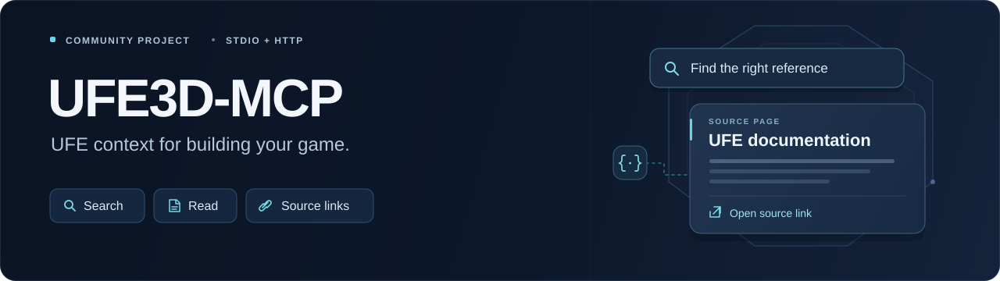

# UFE3D-MCP

**Build and debug Universal Fighting Engine features with your AI coding agent.**

Tell your agent what you want to change in your game. UFE3D-MCP gives it on-demand access to the [official UFE manual](https://www.ufe3d.com/ufe2/docs/#/docs:home), so it can find documented settings and behavior, connect them to your existing implementation, and work toward the change—without you repeatedly finding and pasting documentation pages.

**The MCP supplies UFE reference context. Your agent uses its own project and editor tools to inspect, implement, and test changes.** The connector itself does not read your game project, modify Unity assets, or validate gameplay.

**Python 3.10+ · Local stdio and Streamable HTTP · No model API key required by the connector · [MIT](LICENSE)**

[Agent-assisted setup](#agent-assisted-setup) · [Manual quick start](#quick-start) · [Connect your assistant](#connect-your-assistant) · [Freshness](#documentation-freshness) · [Changelog](CHANGELOG.md)

## Start with something you want to build

After connecting, give your agent a concrete task:

```text
Use UFE3D-MCP to help me add input-buffered combos to my existing UFE game.

Inspect my installed UFE version and current move setup, retrieve the relevant
official documentation, and map the documented options to my project.

Implement the smallest appropriate changes using your available project tools.
Run the relevant checks and tell me what still needs verification in Unity.
Cite the UFE documentation that informed the changes.
```

The intended workflow is **understand the request → inspect the project → retrieve relevant UFE context → implement the requested change → verify**. A question or planning request should produce an answer or plan, not unrequested code edits.

## What it helps you do

| Your development task | How your agent uses UFE3D-MCP |
| --- | --- |
| **Build a feature** | Find documented capabilities and settings, map them to the existing project, and implement the requested change through available project tools. |
| **Debug combat behavior** | Compare documentation with accessible code and configuration, investigate likely causes, and test a scoped correction. |
| **Configure moves and characters** | Retrieve the documented options before recommending project-specific values or changes. |
| **Work on networking** | Gather the relevant rollback and networking context, surface version warnings, and plan or implement the requested change. |
| **Plan unfamiliar work** | Identify relevant settings, affected components, assumptions, and verification steps before editing. |

These are coding-agent workflows supported by documentation retrieval, not new Unity-editing tools. The agent must have the necessary project/editor access and respect the user's requested scope. When it cannot perform an editor operation or gameplay check, it should identify the exact remaining step rather than claim completion.

## Agent-assisted setup

**No skill installation is required.** Give your coding agent this repository or the [standalone setup guide](docs/SETUP.md), then paste:

```text
Read this checkout's README and docs/SETUP.md, then install and register
UFE3D-MCP for this coding assistant. Use the source revision I provided,
or main from Kenneth-Brisco/Universal-Fight-Engine-MCP if none was specified.

Reuse an existing installation when appropriate. Preserve unrelated MCP
connections, permissions, credentials, and project files. Configure one
UFE3D-MCP connection and preserve its cache and launch settings.

Verify through actual MCP calls: check status, search for a UFE topic, and
retrieve a returned document. Allow normal tool discovery when needed.

If you cannot access this machine's settings, or a reconnect or approval is
required, give the exact remaining action and mark verification pending.
Do not report success from a configuration file or CLI-only search.
```

The guide covers local versus remote clients, durable installation, client configuration, and connection evidence. It is ordinary Markdown, usable even when an agent cannot load skills. It does not grant filesystem permissions or client access. **Manual instructions remain below** for unsupported agents or troubleshooting.

The bundled [development skill](skills/ufe-docs/SKILL.md) is optional. It makes the feature-oriented workflow reusable in clients that support plugin skills; it is not needed to install the MCP or use its tools.

## Quick start

You need **Python 3.10+**, [uv](https://docs.astral.sh/uv/getting-started/installation/), Git or an extracted source ZIP, and a client that can launch local MCP servers. Keep the checkout in a permanent folder. If GitHub requests authentication, use an account with access to the repository.

**Install from source:**

```bash
git clone --branch main --single-branch https://github.com/Kenneth-Brisco/Universal-Fight-Engine-MCP.git
cd Universal-Fight-Engine-MCP

uv sync --frozen
uv run --frozen ufe-docs-mcp sync
uv run --frozen ufe-docs-mcp search "input buffer frame links"
```

If you already have a reviewed checkout, use that checkout rather than cloning another copy. Record its commit with `git rev-parse HEAD` before reporting verification. `uv sync --frozen` installs locked dependencies; the documentation `sync` builds the local index. The source adapter respects the publisher's crawl delay (10 seconds in the recorded verification).

For a ZIP installation, download the complete source from `main` or the exact commit you intend to use. Keep the included plugin files and `uv.lock` together with the source.

## Connect your assistant

**Add the `UFE3D-MCP` server to your coding assistant.** Choose either a direct MCP connection or the optional plugin, not both for the same installation.

Generate configuration after placing the checkout in its permanent location. Local entries use absolute interpreter and cache paths. Use the same cache location across clients to share one documentation index.

Run generator commands from the checkout as `uv run --frozen ufe-docs-mcp …`:

| Assistant | Direct MCP connection | Optional plugin |
| --- | --- | --- |
| **Claude Code** | `client-config --format claude-code` prints a `claude mcp add-json --scope user …` command. Inspect and run it. | `claude plugin marketplace add <checkout>` then `claude plugin install ufe3d-mcp@ufe3d-mcp` |
| **Codex** | `client-config --format codex` prints a `[mcp_servers.UFE3D-MCP]` table for `~/.codex/config.toml`. Merge only that entry. | `codex plugin marketplace add <checkout>` then `codex plugin add ufe3d-mcp@ufe3d-mcp` |
| **Cursor** | `client-config --format cursor` prints an entry for `~/.cursor/mcp.json` or the project's `.cursor/mcp.json`. | `export-plugin cursor --out ~/.cursor/plugins/local/ufe3d-mcp`, then reload the app. |
| **Antigravity** | `client-config --format antigravity` prints an entry for `~/.gemini/config/mcp_config.json`. | `export-plugin antigravity --out <new-directory>` then `agy plugin install <new-directory>` |
| **Grok Build** | It can read Claude Code and Cursor MCP settings; otherwise inspect `client-config --format grok` for a `grok mcp add` command. Avoid duplicate registrations. | `grok plugin install <checkout>` adds the skill; the server comes from the MCP connection. |
| **Other local MCP clients** | `client-config` prints a generic `mcpServers` JSON entry; follow the client's schema and configuration location. | Skills are optional and client-dependent. |

For example:

```bash
uv run --frozen ufe-docs-mcp client-config --format codex
uv run --frozen ufe-docs-mcp client-config --format claude-code
```

The table describes generated configuration and plugin support, not a fresh installation in every app. See [verification evidence and limits](VERIFICATION.md).

The generator **prints** configuration; it does not install it. Shell command output targets a POSIX shell. For another shell, use the JSON output or the client's own registration interface. Keep required local environment overrides when configuring the server. Never overwrite an entire client configuration with one generated entry.

Claude Code and Codex plugins launch with `uv run --frozen` from the plugin folder, so `uv` must be available to the client. Cursor and Antigravity exports point at the installed checkout; re-export after moving it. The exporter refuses to overwrite an existing directory. The Cursor desktop app loads local plugins; the Cursor Agent CLI uses MCP configuration instead.

### Names and invocation

| Component | Name |
| --- | --- |
| Product and MCP server registration | `UFE3D-MCP` |
| Plugin and marketplace | `ufe3d-mcp` |
| Optional development skill | `ufe-docs` |
| Python package / executable | `ufe-docs-mcp` |
| Python module | `ufe_docs_mcp` |

Individual tools include `ufe_search_docs` and `ufe_get_doc`. There is no universal MCP slash command. With the Claude Code plugin loaded, the skill is `/ufe3d-mcp:ufe-docs`; other clients expose skills through their own interfaces.

```text
Use UFE3D-MCP to help implement [describe the feature] in this project.
Inspect the relevant project context and UFE version, retrieve the documentation
needed, implement within my requested scope, and verify the change. Cite the
sources and tell me what still needs a Unity check.
```

### Compatibility and privacy

A model name does not establish MCP compatibility: the host application must support local stdio or a deployed Streamable HTTP endpoint. Claude Desktop and hosted web connectors have their own setup; they are not covered by a Claude Code CLI test. Remote-only clients need an actual reachable endpoint, not this GitHub URL or a placeholder localhost address.

Generated settings and local plugin exports contain machine-specific paths. Keep them private. Normal MCP responses omit cache paths and use safe operational errors. Detailed logs, CLI diagnostics, and refresh-state files may still contain local details; redact them before sharing.

[Example JSON](examples/client-config.json) uses placeholder paths. The [setup guide](docs/SETUP.md) defines verification and fallback behavior.

## What is included

| Files | Purpose |
| --- | --- |
| [`src/ufe_docs_mcp/`](src/ufe_docs_mcp/) | Retrieval, search, freshness, and stdio/HTTP MCP serving. |
| [`tests/`](tests/), [`evals/`](evals/) | Automated checks and selected assistant-evaluation cases. |
| [`skills/`](skills/), plugin manifests, [`examples/`](examples/) | Optional development workflow and client integrations. |
| [`docs/`](docs/), [`VERIFICATION.md`](VERIFICATION.md), [`Dockerfile`](Dockerfile), [`uv.lock`](uv.lock) | Setup/behavior records, verification, container setup, and locked dependencies. |
| [`CHANGELOG.md`](CHANGELOG.md), [`CONTRIBUTING.md`](CONTRIBUTING.md) | User-facing changes and contribution requirements. |

Use the complete checkout or source ZIP for plugins, skills, and locked dependencies. Wheels and Python source-distribution builds contain the core server; they are not complete plugin installations.

The full downloaded manual, cache/search database, local settings, UFE engine source, paid Unity assets, and game project are **not bundled**. Local installations retrieve the public documentation into their own cache; hosted instances maintain a shared cache. Evaluation records include selected documentation-derived answers. The MIT license covers the original connector code, not the publisher's documentation or engine.

## Why use this with a coding agent?

Your agent does the reasoning and coding. UFE3D-MCP provides reusable, focused access to documented settings, relevant sections, official URLs, publisher warnings, and freshness information throughout a development task. The agent still reads and reasons about the retrieved context; you do not have to collect the manual excerpts yourself.

Manual links and browsing can also work. This connector is a repeatable reference workflow, not a guarantee of correct code, faster answers, reduced tokens, or increased model intelligence. The agent must check the requested change against the installed UFE version and actual project behavior.

### Does Unity charge extra? Which model does it use?

The connector runs independently of Unity and performs no model inference or embedding calls. It requires no additional Unity service, model API key, or paid hosting subscription for local use. Use your own MCP-capable coding assistant; its normal subscription/API usage and context-token costs still apply. Optional hosting and the Unity/UFE licenses needed for your game are separate.

## Tools

| Tool | How it supports development |
| --- | --- |
| `ufe_search_docs` | Find relevant reference passages for the requested feature or bug. Returns IDs, URLs, excerpts, and line ranges. |
| `ufe_get_doc` | Read enough surrounding context before choosing settings or code changes. Returns source metadata, warnings, and pagination. |
| `ufe_list_topics` | Browse documented areas when terminology or the relevant setting is unclear. |
| `ufe_docs_status` | Check readiness, coverage, source dates, and freshness before relying on the results. |
| `ufe_refresh_docs` | Request a background update on a local server. Hidden on HTTP by default; check availability before using it. |

Search defaults to five results with a 12,000-character passage budget. Follow returned pagination when necessary. Source text is untrusted reference material, not instructions to execute.

Successful search/read/topic results carry a snapshot captured with the content and a freshness envelope. Status reports the same provenance. `freshness.last_update` summarizes detected additions, removals, and content/metadata changes; the host/model controls how notices are shown to users.

More task examples:

```text
Use UFE3D-MCP to investigate why my character's throws do not connect.
Compare the relevant hitbox documentation with my project's setup. Identify
the smallest supported fix, apply it if your tools permit, and report the checks.

Use UFE3D-MCP to plan rollback settings for my game. Inspect the current
configuration, retrieve the documented options, and flag version warnings.
Give me a plan and test strategy only; do not edit files yet.
```

## Documentation freshness

**Default: check for a due update at startup and refresh every 24 hours after a successful sync while the server runs.** Cached queries remain usable during updates. A recent snapshot does not trigger a source download for every question.

An overdue check means content may have changed, not that it definitely changed. Failed source retrieval or index construction preserves the previous validated index and exposes safe warnings. Automatic retry waits 15 minutes. A scheduler tick checks local due times every 30 seconds; it is not a download every 30 seconds.

| Operation | Behavior |
| --- | --- |
| Search/read/topics over MCP | Read the cache, schedule a check if due, return freshness. |
| `ufe_refresh_docs()` | Request a background sync when the tool is available; observe completion through status. |
| `ufe_refresh_docs(refresh_pages=true)` | Explicit full raw-page refresh; potentially 37 minutes or longer at recorded coverage. |
| `sync` / `sync --refresh-pages` | Foreground synchronization using the same coordinator and lock. |
| `serve --offline` | Never download documentation, even when refresh is requested. |

Only one sync runs per cache; a new request neither queues nor upgrades a running refresh. Stdio clients normally own their server process, so stopping the process stops updates. A hosted HTTP server can keep refreshing after clients disconnect, while the host keeps that process running. CLI search/get/topics/status are local reads and do not start the scheduler.

**Catalog versus raw pages:** new caches use UFE's published bulk catalog plus additional visible pages. The catalog can lag edits to individual raw pages. `current_to_catalog` certifies a recent check within that scope, not the currency of every raw page. A full raw refresh explicitly fetches every known public page. After successful raw-mode publication, later syncs retain raw mode and can take just as long. Both modes are snapshots; pages can change during or after a sync. Read source dates and publisher warnings.

```bash
uv run --frozen ufe-docs-mcp sync
# Only when a full raw-page refresh is deliberately needed:
uv run --frozen ufe-docs-mcp sync --refresh-pages
```

There are no independent desktop or Discord notifications. Notices are returned through MCP results.

### Documentation updates and connector updates are separate

The automatic updater changes the documentation cache only—not connector code, dependencies, Unity, or the installed UFE package. Adapter-breaking source changes require a compatible connector release.

Read [CHANGELOG.md](CHANGELOG.md) before upgrading. In a clean checkout on the intended branch, use `git pull --ff-only`, then `uv sync --frozen` and reconnect the client. Do not discard local edits. ZIP installations need a new reviewed archive; regenerate configuration if the installation path or launch settings change.

Routine documentation refreshes belong in freshness/update state, not the connector changelog. See the [specification](docs/SPECIFICATION.md) for the full contract.

## Hosted endpoint

The Python server can also run as a shared Streamable HTTP endpoint. This repository does not provision hosting or publish an endpoint automatically. A GitHub URL is not an MCP URL.

```bash
UFE_DOCS_HTTP_TOKENS="<long random token>" uv run --frozen ufe-docs-mcp serve --transport http --port 8000
```

The default bind is loopback. `/mcp` serves MCP and `/healthz` reports process health/name/version, not index readiness. Binding beyond loopback requires tokens or an explicit `--allow-anonymous` / `UFE_DOCS_ALLOW_ANONYMOUS=1`. Shared tokens are not per-user accounts or OAuth. Use HTTPS and appropriate host/proxy controls for a real deployment.

HTTP hides `ufe_refresh_docs` unless an operator sets `--remote-refresh`; its own scheduler still runs. Remote users with stale/failed data should check status and contact the operator rather than repeatedly invoke an absent tool.

The default request limit is 120 per client per minute. `--trust-proxy` is only appropriate behind a trusted proxy; `--allowed-host` configures accepted hosts. These controls do not constitute an exact spending cap.

Generate remote configuration with:

```bash
uv run --frozen ufe-docs-mcp client-config --format codex --url https://your-host/mcp --token-env UFE_DOCS_TOKEN
```

The URL is a placeholder; use your operator's actual endpoint. Verify the client's authentication support. Antigravity emits a private token placeholder rather than documented environment expansion; generic JSON clients must support the emitted variable syntax. Never publish real tokens or paste them into support issues.

See [docs/HOSTING.md](docs/HOSTING.md) and the included Dockerfile. Hosting remains optional.

## Verification and coverage

[VERIFICATION.md](VERIFICATION.md) records automated checks and client evidence with the exact revisions tested. [Onboarding verification](docs/ONBOARDING-VERIFICATION.md) defines the status → search → get-document checks needed for a working installation. Generated configuration alone does not establish compatibility with every app.

The recorded real cache contains 223 visible pages/sections and 1,010 chunks. Coverage follows the indexed manual's public navigation, not every UFE website or every C# API. The manual is not version-pinned; absence from search does not prove a feature is absent. Check status for your installation's coverage and freshness.

The synthetic suite exercises stdio, HTTP, generated configuration, and privacy failures. Recorded client rehearsals have separate limits; they do not establish a public HTTPS deployment or successful implementation of a game feature. The selected model evaluation used a baseline without web access and does not establish superiority to browsing, time/token savings, or gameplay correctness. See [evals/README.md](evals/README.md).

## Troubleshooting and advanced setup

| Symptom | Action |
| --- | --- |
| Tools are missing | Check the intended client's configuration/scope, reconnect, allow discovery, and inspect UFE-specific permissions. |
| Index is unavailable | Finish normal `sync` for a local installation; for a hosted endpoint, ask the operator. |
| A moved installation fails | Regenerate interpreter/cache paths or re-export the plugin. |
| Different clients see different snapshots | Verify that they use the intended shared cache or the same remote endpoint. |
| Refresh is failed or overdue | Preserve the warning. Use refresh only if available and appropriate, or contact the host operator. |
| Cursor drops plugin tools | Open a project folder, reload the window, then test from a fresh chat. |
| Duplicate UFE3D-MCP tools appear | Use one direct or plugin-provided connection. Check project and user scopes; preserve unrelated servers and permissions. |

<details>
<summary>Change update cadence or work offline</summary>

```bash
uv run --frozen ufe-docs-mcp serve --refresh-hours 6
uv run --frozen ufe-docs-mcp serve --no-auto-refresh
uv run --frozen ufe-docs-mcp serve --offline
```

For a local client, append the chosen options after `serve` in its generated arguments. Intervals must be finite and at least one hour. Disabling automatic refresh still allows explicit online refresh; offline mode never downloads. An empty offline cache cannot answer documentation queries.

</details>

<details>
<summary>Cache locations and a custom folder</summary>

| Platform | Default index |
| --- | --- |
| macOS | `~/Library/Caches/ufe-docs-mcp/docs.sqlite3` |
| Windows | `%LOCALAPPDATA%\ufe-docs-mcp\docs.sqlite3` |
| Linux | `${XDG_CACHE_HOME:-~/.cache}/ufe-docs-mcp/docs.sqlite3` |

Set `UFE_DOCS_CACHE_DIR` or put `--cache-dir` before the subcommand:

```bash
uv run --frozen ufe-docs-mcp --cache-dir /absolute/path/to/ufe-docs-cache sync
uv run --frozen ufe-docs-mcp --cache-dir /absolute/path/to/ufe-docs-cache client-config
```

Use the same location for serving and synchronization. Paths above are generic examples, not distributed personal configuration.

</details>

<details>
<summary>Install without uv (macOS/Linux)</summary>

```bash
python3 -m venv .venv
source .venv/bin/activate
python -m pip install .
ufe-docs-mcp sync
ufe-docs-mcp client-config
```

This does not apply the transitive dependency resolution in `uv.lock`. Plugins configured to launch `uv` still require it; this fallback is for a direct MCP connection.

</details>

## Community, sources, and license

Contributions can improve setup, documentation retrieval, client compatibility, and useful development examples. Read [CONTRIBUTING.md](CONTRIBUTING.md) and keep [CHANGELOG.md](CHANGELOG.md) updated for meaningful user-facing changes.

Share redacted reproductions rather than personal configuration, caches, or full local logs. Report issues and contribute changes in [Kenneth-Brisco/Universal-Fight-Engine-MCP](https://github.com/Kenneth-Brisco/Universal-Fight-Engine-MCP).

Official sources: [manual](https://www.ufe3d.com/ufe2/docs/#/docs:home) · [catalog](https://www.ufe3d.com/ufe2/docs/assets/site-data.json) · [release notes](https://www.ufe3d.com/ufe2/changelog.html) · [crawl rules](https://www.ufe3d.com/robots.txt).

The original connector is [MIT licensed](LICENSE). UFE documentation and engine assets retain their publisher's ownership and terms. This is an independent community project, not an official UFE product.
